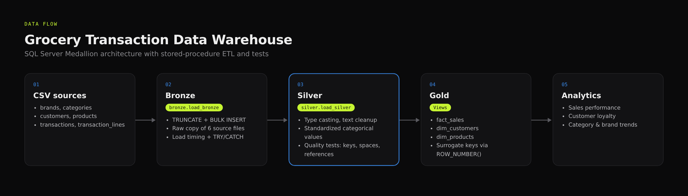
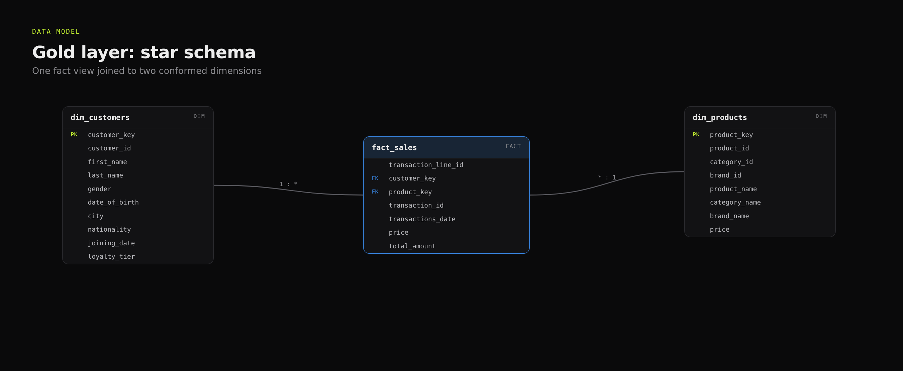
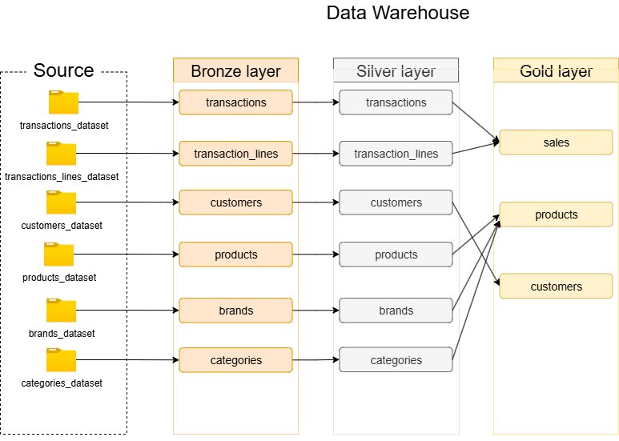
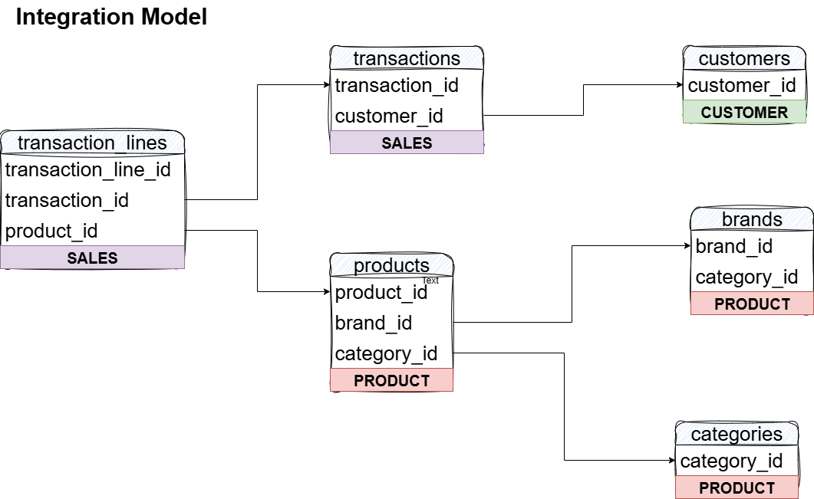
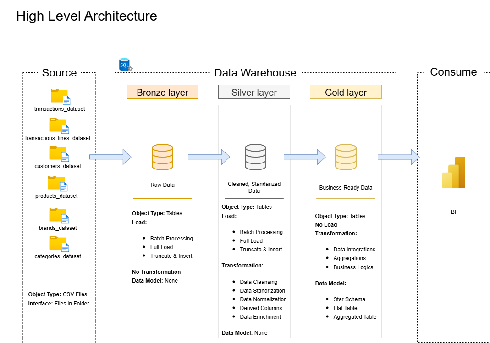
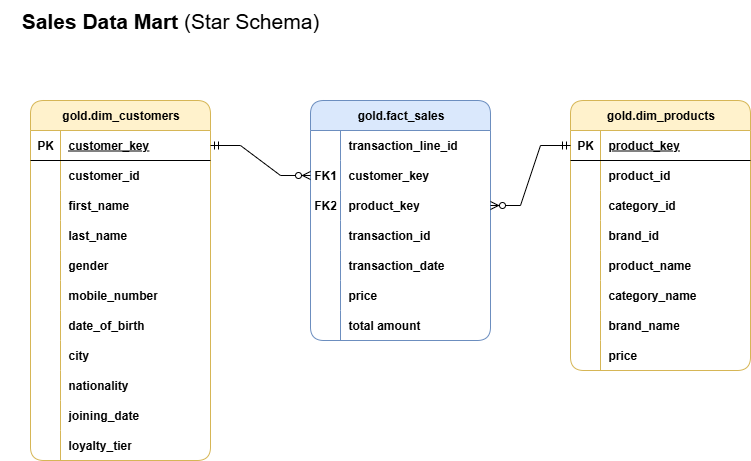
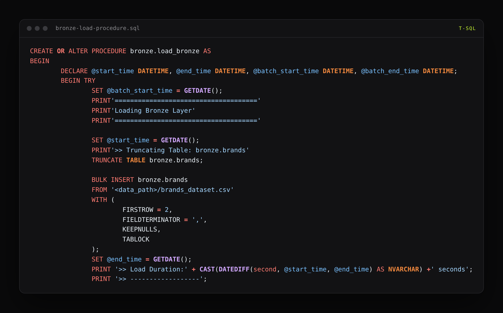
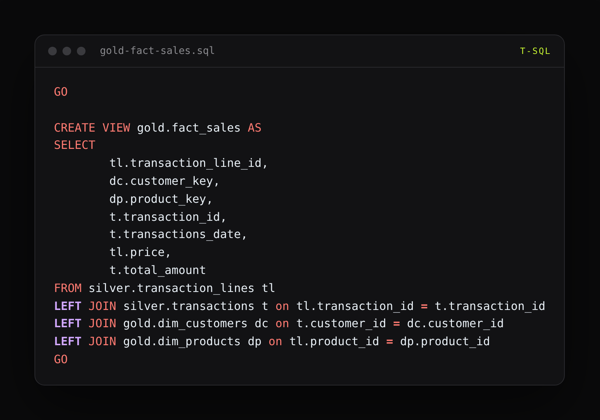
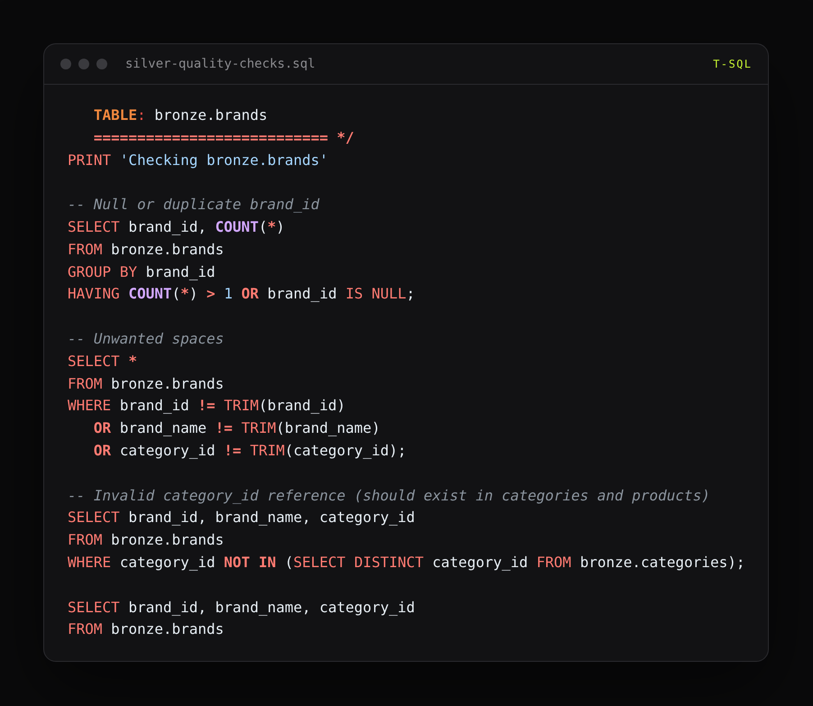

# Grocery Transaction Data Warehouse (SQL Server · Medallion Architecture)

An end-to-end data warehouse in SQL Server (Jul–Aug 2025) that turns raw grocery-transaction CSV extracts into a business-ready star schema. It uses a **Bronze → Silver → Gold** (Medallion) design, stored-procedure ETL, and automated data-quality checks.


## Why
Retail transaction data typically arrives as messy, disconnected extracts. This project shows how to make it trustworthy and fast to query: land it raw, clean and standardize it, then model it for analytics on sales, customers, and product performance.

## Data source
Built on the public **Supermarket Transactional Data** dataset by Nadin Ramadan on Kaggle (brands, categories, customers, products, transactions, transaction_lines):
https://www.kaggle.com/datasets/nadinramadan/supermarket-transactional-data
All credit for the raw data goes to the dataset author. The warehouse design, ETL, tests, and documentation are my own work.

## Architecture
| Layer | Purpose | How it is loaded |
|---|---|---|
| **Bronze** | Raw copy of source CSVs (brands, categories, customers, products, transactions, transaction lines) | `bronze.load_bronze`: truncate + `BULK INSERT`, with load timing and error handling |
| **Silver** | Cleaned and standardized data: type casting, value normalization, text cleanup | `silver.load_silver`, with per-table load timing |
| **Gold** | Business-ready star schema: `dim_customers`, `dim_products`, `fact_sales` (views) | `ddl_gold.sql` |

Diagrams: [data flow](docs/DATAFLOW.drawio.png) · [integration model](docs/data_integration.drawio.png) · [star schema](docs/StarSchema.drawio.png)

## Data quality
- `tests/quality_check_silver.sql`: checks every table for null or duplicate keys, unwanted whitespace, broken references between tables, and unexpected categorical values (gender, loyalty tier, nationality)
- `tests/quality_check_gold.sql`: checks surrogate-key uniqueness and referential integrity between facts and dimensions

## Documentation
- [`docs/data_catalog.md`](docs/data_catalog.md): column-level catalog of the Gold layer
- [`docs/naming_conventions.md`](docs/naming_conventions.md): naming rules for schemas, tables, columns, and procedures

## Repository structure
```
scripts/
  init_database.sql        create database and bronze/silver/gold schemas
  bronze/                  DDL + load procedure
  silver/                  DDL + transform procedure
  gold/                    star-schema views
tests/                     data-quality checks
docs/                      architecture diagrams, catalog, conventions
```

## How to run
1. Run `scripts/init_database.sql` in SQL Server Management Studio.
2. Create the tables: `bronze/ddl_bronze.sql`, then `silver/ddl_silver.sql`.
3. Update the CSV file paths in `proc_load_bronze.sql`, then run `EXEC bronze.load_bronze;` followed by `EXEC silver.load_silver;`.
4. Run `gold/ddl_gold.sql`, then the scripts in `tests/`.

## Skills demonstrated
Data warehouse design · Medallion architecture · dimensional modeling · stored-procedure ETL with logging and error handling · data-quality testing · technical documentation

## Gallery

**Data flow**



**Data model**



**Architecture: dataflow drawio**



**Architecture: integration model**



**Architecture: medallion**



**Architecture: star schema**



**Code: bronze load procedure**



**Code: gold fact sales**



**Code: silver quality checks**


